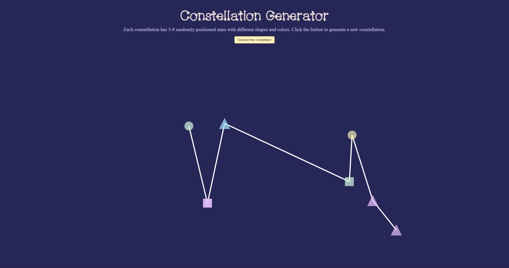

Assignment 1 - Hello World: GitHub and d3  
===

## Overview

A star constellation generator, each constellation contains 3–8 randomly positioned stars, represented by circles, squares, and triangles in five colors. Stars are connected by white lines.
Click **Generate New Constellation** to reload the page and create a new pattern.

Website link: https://vhmnguyen.github.io/a1-ghd3/ 

## Technical Achievement

- **Random generation:** Randomly selects the star count, positions, shapes, and colors each time the page loads.
- **Overlap check:** Checks the distance between each potential new position against existing stars. Positions less than 35 drawing units apart are rejected and redrawn. There's a limit of 100 redrawing attempts to prevent an endless loop.
- **Line crossing check:** Avoids lines crossing by sorting stars by horizontal coord before connecting.
- **Twinkle effect:** Uses repeating transitions to animate each star's opacity between 0.7 and 1 --> simulate random twinkling effect.

## Design Achievement

I used Coolors to generate the color palette for the stars and to select the background and h1 colors.
The custom font for h1 where found on FontSpace, credited below.

## Sources

- **Coolors color palette:** https://coolors.co
- **Coolors color contrast checker:** https://coolors.co/contrast-checker/112a46-acc8e5
- **MidnightConstellations Font:** https://www.fontspace.com/midnightconstellations-font-f24423
- **Codex:** Codex was used to help me figure the implementation of the twinkling effect and autocompleting sections of the code. No AI was used for designing.
